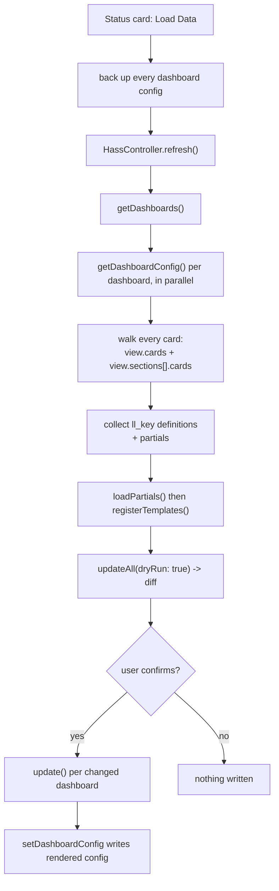

# Dashboard sync and the Home Assistant API

Everything runs in the user's browser against `hass.callWS`. A sync **overwrites
the user's dashboard config**, so correctness here is destructive-by-default.

## The websocket calls (`src/linked-lovelace-api.ts`)

| Method | WS type | Notes |
|---|---|---|
| `getDashboards` | `lovelace/dashboards/list` | Prepends a synthetic `overview` entry with `url_path: ''`. |
| `getDashboardConfig` | `lovelace/config` | `url_path: null` means the overview dashboard. Returned as-is. |
| `setDashboardConfig` | `lovelace/config/save` | No-op when `Debug.instance.dryRun` is set. |
| `createDashboard` | `lovelace/dashboards/create` | Used only by the Starter card. |

Two path conventions meet here and they are easy to mix up: the dashboard list
uses `''` for the overview, the `lovelace/config` calls want `null`.
`HassController.update` does that conversion (`urlPath === '' ? null : urlPath`).
Keep it.

## Sync flow

## Rules that keep syncs safe

- **There are three consumers of the walk, not two.** `src/helpers/views.ts`
  exports `cardsInView`; `HassController.refresh` uses it, and so does the docs
  playground (`docs_site/.vitepress/theme/components/engine.ts`), which
  reimplements the sync loop in the browser without websockets. A change to how
  cards are found or how collisions resolve has to land in the helper, or the
  published demo starts lying about what a real sync does.
- **Discovery and rendering must walk the same places.** They drifted once: the
  2024.3 sections support (PR #32) taught rendering to walk
  `view.sections[].cards[]` but left discovery reading `view.cards` only, so a
  template defined inside a section never registered. If you add a new place a
  card can live, change both `HassController.refresh` (`cardsInView`) and
  `LinkedLovelaceController.getUpdatedDashboardConfig`.
- **Absence of `views` means "skip this dashboard".** Strategy-driven dashboards
  (the Map view, auto-generated overviews) have no `views` key.
  `getUpdatedDashboardConfig` returns early on that, which only works if the API
  layer does not helpfully default `views: []`. Do not re-add that default.
- **Never write during discovery.** `refresh()` is read-only; only `update()`
  writes, and only when `dryRun` is false and the user confirmed.
- **Every dashboard read is fallible.** A failed `getDashboardConfig` is logged
  and skipped, never thrown, so one broken dashboard cannot block a sync.
- **Key collisions: lowest `ll_priority` wins, and always warn.** A duplicate
  `ll_key` means two views claim the same template name; the surviving one must
  be the lowest priority so it is still registered before anything referencing
  it.
- **Per-view bookkeeping merges, it does not assign.**
  `dashboardsToViews[path][view].templates` and `.partials` accumulate across
  the cards of a view; plain assignment drops everything the earlier cards found
  (the Partials tab went half-empty this way).

## Testability

`HassController` is testable: stub `(GlobalLinkedLovelace as any).self = { api: {...} }`
and call `refresh()`. See `src/controllers/hass.test.ts`. Two things made it
untestable for a long time and must not come back:

- Non-relative `src/...` imports. `tsconfig` has `baseUrl: "./"` so rollup
  resolves them, but Jest does not. Always import relatively inside `src/`.
- Unguarded `window` access. Log strings go through the `origin()` helper, which
  returns `''` outside a browser.

## Lit card notes

The status card (`src/linked-lovelace-status.ts`) mutates `@state` objects in
place and calls `_repaint()` (flipping a boolean) to force a re-render. That is
deliberate; do not "fix" it into reassignment without checking
`shouldUpdate`. `confirm()` gates every write, and the backup JSON the card
offers for download is the user's only undo.
