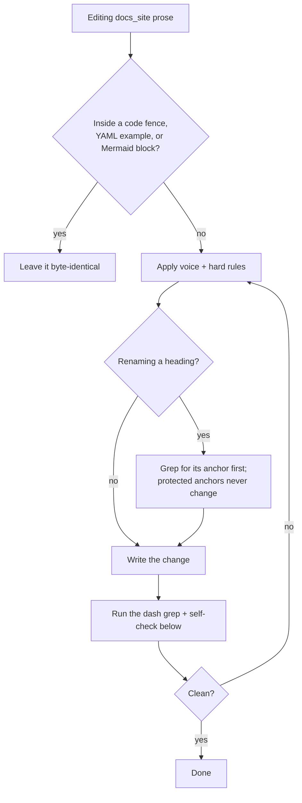

# Docs writing style — docs_site/

The docs were edited in July 2026 to remove AI-sounding prose (Wikipedia
"Signs of AI writing" patterns). Keep them that way. These rules apply to all
prose in `docs_site/*.md` and README text; they do not apply to code blocks,
YAML examples, or Mermaid diagram syntax.

## Voice

The site has a first-person, opinionated maintainer voice. Preserve it.
Existing examples that are intentional and must survive edits:

- "I didn't want to figure out how to use the Jinja library... The documentation is weak." (providing-template-context.md)
- "Great for experts, but definitely a risky click after making changes!" (using-the-status-card.md)
- "A.K.A killing the user's battery" (using-the-status-card.md)

Write new prose the same way: plain sentences, direct address ("you"), the
occasional aside or opinion. Reference pages (api-reference, template-syntax,
troubleshooting) stay neutral and plain; tutorial pages can be looser.

## Hard rules

1. **No em dashes (—) or en dashes (–) anywhere**, including Mermaid node
   labels and YAML comments. Replace with a period, comma, colon, or
   parentheses. Verify with:
   `grep -rn "—\|–" --include="*.md" docs_site --exclude-dir=node_modules`
2. **No emoji** in headings, bullets, or tables. Use "Yes"/"No" in table
   cells, never ✅/❌/—. Exception: emoji that are literal card output the
   demo renders (the 🟢 / ⚪ / ❔ icons in starter-dashboard.md).
3. **Bold sparingly.** Bold is for UI element names the reader clicks or
   sees (**Load Data**, **Update All**, **Templates** view) and for the
   standing `**Type:**` labels in api-reference.md. Never bold for emphasis
   on ordinary words (not, same, downward, are). Use italics for rare
   contrastive emphasis (*do* persist).
4. **No bold-header bullet lists** ("- **Performance:** ..." or
   "- **Fastest**: ..."). Fold the items into prose sentences, or write
   plain list items that start with the actual instruction.
5. **No marketing punchlines or rule-of-three taglines.** Banned patterns:
   "author once, reuse everywhere, sync on demand"; "No X. Nothing to Y.
   Nothing Z."; "Feel the power". Say the concrete benefit instead: "you
   write a card once and sync it wherever it's used."
6. **Prefer is/are/has** over "serves as", "boasts", "features",
   "represents". Avoid the AI vocabulary set: seamless, powerful, robust,
   comprehensive, leverage, delve, showcase, vibrant, crucial, pivotal.
7. **No "-ing" tack-ons** for fake depth ("...enabling powerful workflows",
   "...ensuring consistency"). End the sentence, or state the consequence
   as its own sentence.
8. **Straight quotes only** in prose (", not ").

## Structure conventions

- **Headings:** the site uses Title Case for H1/H2 (existing style; keep it
  consistent rather than mixing). Use "Pattern 1: Registration-time nesting"
  style (colon, sentence case after) for sub-variants.
- **Protected anchors.** These heading texts are link targets from other
  pages; do not rename them:
  - `advanced-features.md`: "ll_keys In Depth" (`#ll-keys-in-depth`),
    "Migration From V1" (`#migration-from-v1`)
  - `troubleshooting.md`: "Template Not Found" (`#template-not-found`)
  - `api-reference.md`: "ll_keys" (`#ll-keys`)
  If you must rename a heading, grep the docs for its anchor first:
  `grep -rn "#anchor-name" --include="*.md" docs_site --exclude-dir=node_modules`
- **Nav link lists** ("Where to next?" / "What's Next?") are plain bullets
  where the link is the subject of a real sentence: "- [Live Demo](./demo)
  runs the same showcase in your browser." Not "- **Live Demo** — the same
  showcase".
- **The danger NOTE block** about browser-context writes is duplicated
  verbatim across tutorial pages. Keep the wording identical everywhere; if
  you change it, change every copy.
- **VitePress containers** (`::: tip`, `::: info`, `::: danger`) are the
  house style for asides; use them instead of blockquotes.
- **Requirement tables** in api-reference.md use columns
  Key / Type / Required / Description with Required as "Yes", "No", or
  "Yes, unless `x` is set".

## Edit flow

## Self-check before finishing a docs edit

- Run the dash grep (rule 1). Zero hits outside node_modules.
- Scan your added text for bold: is every bolded phrase a clickable UI name?
- Read the last paragraph of the page aloud: if it sounds like a slogan or
  a generic upbeat close, replace it with a concrete next step or link.
- Code fences, YAML keys (`ll_key`, `ll_template`, `ll_context`, `ll_keys`,
  `ll_priority`), and Mermaid diagrams must be byte-identical unless the
  edit is specifically about them.
