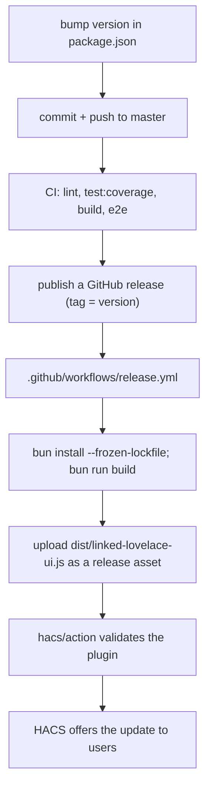

# Releasing (GitHub + HACS)

Users install the card through HACS, which reads `hacs.json` and downloads the
`linked-lovelace-ui.js` asset attached to a GitHub release. `dist/` is
gitignored: the release workflow builds it.

## Steps

1. Bump `version` in `package.json`. Nothing else holds the version:
   `src/version.ts` is generated by `make-version` on every `prebuild` /
   `prestart` and is gitignored, so never hand-edit or commit it.
2. Push to master and let Build + E2E pass. Both are required checks.
3. Publish a GitHub release. The tag becomes the HACS version users see.
4. The release workflow rebuilds from a clean checkout and attaches the bundle
   under the exact name `linked-lovelace-ui.js` (matched by `hacs.json`'s
   `filename`). Renaming the bundle breaks every existing install.

There is no CHANGELOG file in this repo; release notes live on the GitHub
release. `hacs.json` sets `render_readme: true`, so `README.md` is what users
read inside HACS.

## Workflow conventions

- Four workflows: `build.yml` (lint/test/build), `e2e.yml` (Playwright against
  real HA), `deploy.yml` (VitePress docs to GitHub Pages on push to master),
  `release.yml` (on release published).
- **Every action is pinned to a commit SHA** with the version in a trailing
  comment. Keep that pattern when editing or adding a step; a bare `@v4` is a
  regression.
- Bun is the toolchain (`oven-sh/setup-bun`, `bun install --frozen-lockfile`).
  `mise.toml` pins the local node and bun versions; keep the CI bun version and
  `mise.toml` in step.
- Docs deploy runs from `docs_site/` with its own `bun.lock`. A docs-only change
  still needs that lockfile committed or `--frozen-lockfile` fails.
