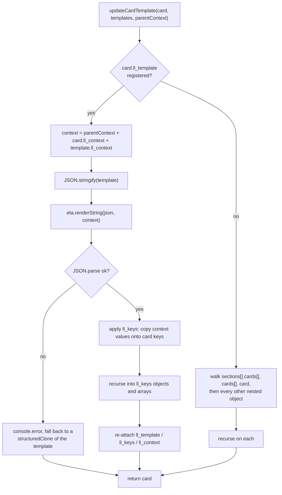

# Template rendering core

`updateCardTemplate` (`src/helpers/templates.ts`) is the heart of the project.
Almost every bug in 143 commits of history landed here. Read this before
editing it.

## The ll_* contract

| Key | Lives on | Meaning |
|---|---|---|
| `ll_key` | definition card | Registers this card as a template under that name. |
| `ll_priority` | definition card | Registration order, ascending. Lower registers first, so a template can only reference templates with a lower priority. Default `0`. |
| `ll_template` | instance card | Render the named template in place of this card. |
| `ll_context` | either | Variables handed to Eta as `context`. |
| `ll_keys` | instance card | Map a key on this card to a key in the context, so whole objects and arrays (not just strings) can be injected. |

Definition cards and instance cards are both ordinary cards in an ordinary
dashboard. There is no backend: everything happens in the browser, and a sync
writes rendered output back over the user's dashboard config.

## How one card renders

Two things fall out of that shape and explain most surprises:

1. **Rendering is a JSON round-trip.** The template is serialized, rendered as
   text, then parsed. A context value containing a `"` produces invalid JSON,
   the parse throws, and the card silently falls back to the **unrendered
   template body**. Same for a value that injects a `\` or a raw newline. If a
   user reports "my card shows `<%= context.x %>` literally", look here first.
2. **Everything nested is walked.** When a card has no `ll_template`, the
   function recurses into every object-valued key, which is how a template
   inside `tap_action` or inside a `sections` grid still renders. It also means
   `ll_context` itself gets walked, and that anything deeply recursive has to be
   copied rather than shared.

## Invariants to preserve

- **Never hand out a registered template by reference.** Copy it
  (`structuredClone`). A shared reference lets one card's edits leak into every
  other card using the same `ll_template`. This is what the fallback branch
  used to do.
- **Output must be idempotent.** Syncing a dashboard twice must produce a
  byte-identical config; the second sync reads its own output. Tests in
  `src/helpers/templates.extended.test.ts` cover this ("two renders with
  identical input produce identical output"). Key-chip wrapping has the same
  requirement (`src/v2/linkedLovelace.test.ts`).
- **Numbers stay numbers.** `leaves numbers as numbers` guards the round-trip.
- **`ll_context` must not be written back into source cards.** See PR #41; the
  fix was to stop persisting context onto definition cards.
- **Card objects must not become arrays.** See PR #37 and #35: `card:` (single)
  and `cards:` (list) are different shapes and both must survive.
- Guard against runaway recursion. A "max stack call" bug (Feb 2023) came from
  templates referencing each other; `ll_priority` ordering plus rendering a
  template at registration time is what keeps it finite.

## Registration and the engine

`TemplateController.renderAndAddTemplate` strips `ll_key` / `ll_priority`, then
renders the definition **against all previously registered templates** before
storing it. So a template is stored already-resolved, and nesting only works
downward in priority order.

`TemplateEngine` (`src/v2/template-engine.ts`) is a singleton wrapper around
Eta configured with `varName: 'context'` and `autoEscape: false`. The
module-level `engine` export is immediately replaced by `refresh()` in the
constructor; keep the two option objects identical so the dead one does not
read as the live config. Partials (`<%~ include('key') %>`) are loaded into the
same Eta instance by `EtaTemplateController.loadPartials`, sorted by priority
ascending, and `HassController.refresh` then points
`TemplateEngine.instance.eta` at that engine.

## Known rough edges

- Quote/backslash values break the JSON round-trip (above). A real fix means
  escaping context values for JSON rather than rendering raw, and would need
  broad e2e coverage before it is safe.
- `getTemplatesUsedInCard` / `getTemplatesUsedInView` are exported but unused by
  the app, and they do not walk `sections` or `ll_keys`. Do not build on them
  without fixing them first.
- View-level `badges` are never rendered. Only `view.cards` and
  `view.sections[].cards` are walked by `getUpdatedDashboardConfig`.

## The docs playground runs this code

`docs_site/.vitepress/theme/components/engine.ts` imports `updateCardTemplate`,
`TemplateEngine`, `unwrapKeyChipCard` and `cardsInView` directly from `src/`, so
a rendering change ships to the published demo on the next docs build. It
reimplements only the websocket-free sync loop. If you change render behavior,
build the docs (`cd docs_site && bun run docs:build`) as well as running Jest.

## Before you finish

Run `bun run test`. If behavior changed at all, add a case to
`src/helpers/templates.extended.test.ts` and re-read the idempotency tests: a
rendering change that is not idempotent corrupts user dashboards on the second
sync.
