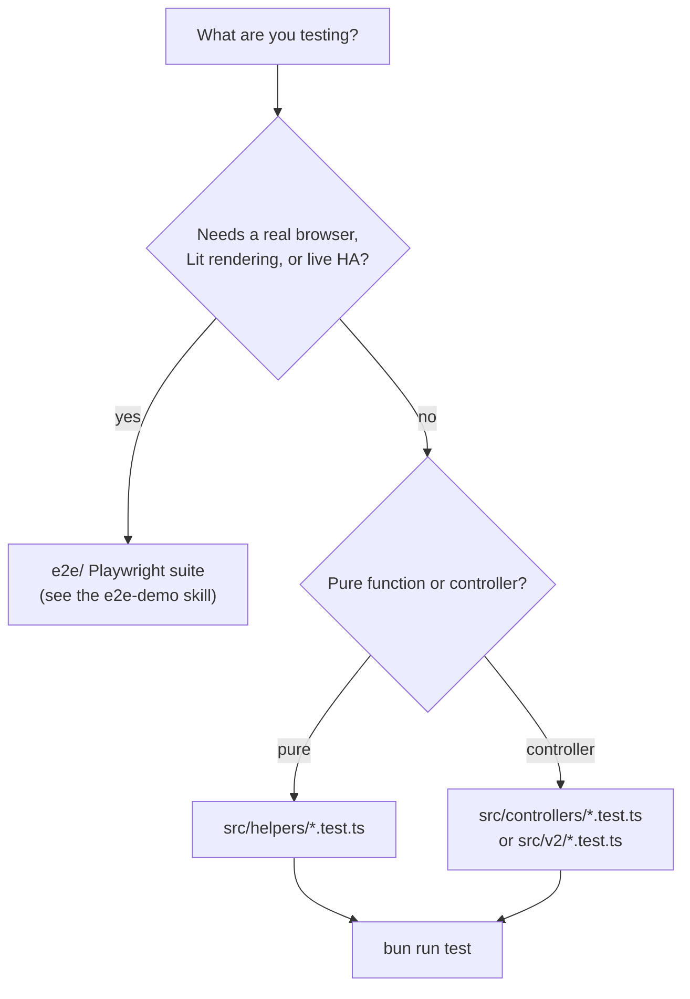

# Unit testing (Jest, src/)

```bash
bun run test              # jest
bun run test:coverage     # jest --coverage, enforces the thresholds
bun x jest src/helpers/templates.extended.test.ts   # one file
```

`jest.config.cjs`: `ts-jest` preset, `testEnvironment: node`, `roots: ["<rootDir>/src"]`.
CI runs `lint` + `test:coverage` + `build` on every PR to master.

## Where a test goes



Jest covers the render engine and controllers. It cannot cover the Lit card
classes (no DOM environment, and `jest-environment-jsdom` is not installed) or
anything that needs the real Lovelace websocket API; that is what the Playwright
suite is for.

## Pitfalls that have cost real time

- **Import relatively inside `src/`.** `tsconfig.json` sets `baseUrl: "./"`, so
  `import x from 'src/types'` compiles and rollup bundles it, but Jest fails with
  `Cannot find module 'src/types'` and the whole suite for that file never runs.
  This is why `src/controllers/hass.ts` had no tests for over a year.
- **`window` does not exist in the node test environment.** Production code that
  builds log strings from `window.location.origin` must go through a guard
  (`origin()` in `hass.ts`). Reaching for `testEnvironment: jsdom` instead means
  adding a dependency.
- **Adding a test file to `src/` changes coverage numbers.** The thresholds in
  `jest.config.cjs` (statements 22, branches 18, functions 17, lines 22) sit just
  under the current values and `collectCoverageFrom` counts every source file,
  including untested Lit cards. Raise the floor when you add real coverage;
  never lower it to make a run pass.

## Mocking patterns

Both singletons are stubbed by assigning their private `self`:

```ts
// Home Assistant API
(GlobalLinkedLovelace as any).self = {
  api: {
    getDashboards: jest.fn().mockImplementation(async () => dashboards),
    getDashboardConfig: jest.fn().mockImplementation(async (p) => structuredClone(configs[p ?? ''])),
    setDashboardConfig: jest.fn(),
  },
};
```

Always hand out a **copy** of a fixture config from `getDashboardConfig`. The
render pipeline mutates what it is given, so a shared fixture makes the second
test in a file fail for reasons that have nothing to do with the code.

For the Eta engine, construct a fresh `TemplateEngine` (or call `refresh()`)
rather than relying on `TemplateEngine.instance`, which carries loaded partials
across tests.

## Style

Describe blocks are named `[function] name` or `[class] Name`; extended
behavior lives in `*.extended.test.ts` with a header comment listing what the
file covers. When a test encodes a bug that actually shipped, say so in a
comment with the PR number, the way the existing files do (`see PR #37, #41`).
