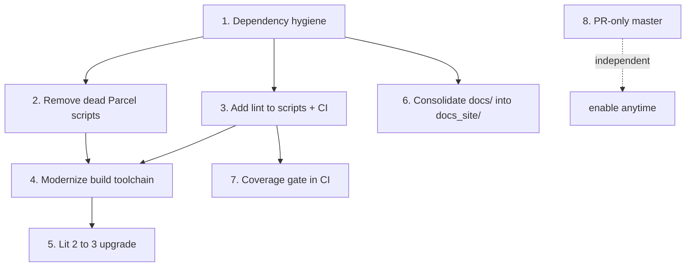

# Repo-Wide Improvements

Local working doc, July 2026. Findings from a pass over `package.json`, CI
workflows, `src/`, `docs/`, `docs_site/`, and `e2e/`. Ordered by
impact-to-effort. Nothing here is committed policy; delete lines as they land.

## Suggested order

## 1. Dependency hygiene (high impact, low effort)

- `jest`, `ts-jest`, `ts-node`, and `typescript` sit in `dependencies`.
  They are build/test tools; move them to `devDependencies`. Consumers of
  the package should not pull in jest.
- `eta` is installed from a vendored tarball (`./eta-3.0.3.tgz`). Document
  why (patched build? registry issue?) or switch back to the registry
  version so `yarn upgrade` and audit tooling see it.
- `yaml` is hard-pinned at `1.10.0` in the root while `docs_site` uses
  `^2.4.5`. Two majors of the same parser in one repo invites subtle
  serialization differences (the demo "writes back" YAML with v2 that the
  card would write with v1). Align on v2.
- `axios` is a full HTTP client used for exactly one `GET` in
  `src/helpers/eta.ts`. Native `fetch` works in every browser HA supports;
  dropping axios shrinks the bundle.
- `string.prototype.replaceall` polyfill: `String.replaceAll` has been
  baseline since 2020; the polyfill can likely go.

## 2. Remove dead Parcel scripts (low effort)

`watch`, `obuild`, and `ostart` invoke `parcel`, which is not installed.
`clean` still removes `.parcel-cache`. The real pipeline is rollup
(`start`/`build`). Delete the dead scripts so `npm run` output matches
reality.

## 3. Lint in scripts and CI (low effort)

`.eslintrc.js` and `.prettierrc.js` exist but there is no `lint` script and
`build.yml` runs only `yarn test` + `yarn build`. Add `lint` /
`lint:fix` scripts and a CI step so the configs actually gate anything.

## 4. Modernize the build toolchain (medium effort)

Rollup 3 with a mix of deprecated community plugins:
`rollup-plugin-terser`, `rollup-plugin-babel`, `rollup-plugin-commonjs`,
`rollup-plugin-node-resolve@5`. All have first-party `@rollup/plugin-*`
replacements; terser moved to `@rollup/plugin-terser`. Upgrading to
rollup 4 + official plugins removes several unmaintained transitive trees.

## 5. Lit 2 to 3 (medium effort, after toolchain)

`lit@^2.0.0` plus `@lit-labs/scoped-registry-mixin@^1`. Lit 3 is a small
migration (mostly decorator/TS config) and gets current fixes. Do after
item 4 so the bundler churn happens once.

## 6. Consolidate docs/ into docs_site/ (medium effort)

Three documentation surfaces exist: `docs/` (design.md, E2E.md, imgs),
`docs_site/` (the published VitePress site), and `v1-README.md`. Move
`docs/design.md` and `docs/E2E.md` content into the site (Internals group,
next to Lifecycles), keep images where the site can serve them, and shrink
`v1-README.md` to a pointer from the site's migration section. One source
of truth; the site already has search.

## 7. Coverage gate in CI (low effort)

Unit tests exist for helpers, controllers, v2 engine, and the demo
dashboard; e2e runs a real Home Assistant. Neither reports coverage. Add
`jest --coverage` with a modest threshold to `build.yml` so regressions in
untested areas (e.g. `src/controllers/hass.ts`, the Lit card classes) are
visible before they grow.

## 8. Make master PR-only in practice (process)

`e2e.yml` comments call e2e a "required check for merging into master", and
the remote has a "changes must be made through a pull request" rule, but
direct pushes currently bypass it (observed on push today). Either drop the
bypass for admins or start branching for day-to-day work so the required
checks actually run before code lands.

## Quick wins checklist

- [x] Move test tooling to `devDependencies`
- [x] Delete `watch` / `obuild` / `ostart` scripts and `.parcel-cache` from `clean`
- [x] Add `lint` script + CI step
- [x] Replace axios with `fetch` in `src/helpers/eta.ts`
- [x] Drop `string.prototype.replaceall`
- [x] Align `yaml` on v2 across root and docs_site (root copy was unused; removed)
- [x] Document or remove the vendored `eta` tarball (documented in README Development)
- [x] Rollup 4 + `@rollup/plugin-*` (plus bun + mise, yarn removed repo-wide)
- [x] Lit 3
- [x] Fold `docs/` into `docs_site/` (internal/ excluded from publish)
- [x] Jest coverage threshold in `build.yml`
- [ ] Stop direct pushes to master
