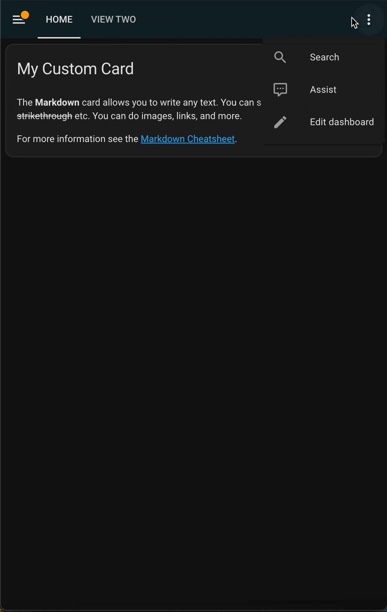
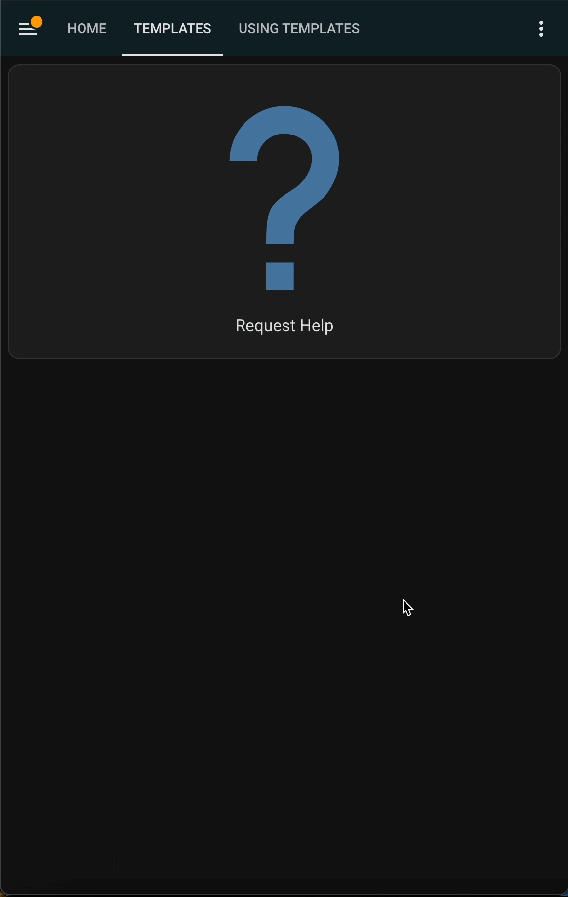

# Creating Your First Template

::: danger NOTE

Linked Lovelace runs commands on behalf of the user's browser to modify dashboard configurations, not on behalf of the Home Assistant system. A user's access may modify the outcome of the program.

__Always back-up your configs if you feel unsure about what you are about to do!__
:::

## What Defines a Card as Reusable?

In our case, it would be a card that we want to use multiple times.

Without Linked Lovelace, the only way to synchronize a card made in the UI is to copy the code in the code editor, and paste it where you want the update to go.

*The Copy Paste Method*


For our example, we'll be creating a button card that creates a persistent notification to help demonstrate synchronization.

## Making a Card Into a Template

To mark a card as a template for Linked Lovelace to consume, we need to add the key `ll_key` to the top-level of the card's YAML. This will break the UI editor.

Before:

```yaml
show_name: true
show_icon: true
type: button
tap_action:
  action: call-service
  service: notify.persistent_notification
  target: {}
  data:
    message: A user needs help
    title: Help Wanted!
icon: mdi:help
name: Request Help
```

After:

```yaml
ll_key: help-button
show_name: true
show_icon: true
type: button
tap_action:
  action: call-service
  service: notify.persistent_notification
  target: {}
  data:
    message: A user needs help
    title: Help Wanted!
icon: mdi:help
name: Request Help
```

By adding this single line Linked Lovelace becomes able to identify `help-button` as a template.

*Converting a card into a template*


## Use the Template

Now that we've created our first template, we'll use it on a new Dashboard/View. Add a card, then add the top level key `ll_template` with a value that matches the `ll_key` we created earlier:

```yaml
type: button
ll_template: help-button
```

This card is now an instance of the template. It looks like a blank button until the first sync.

## Synchronize the Template

While we've created our template and placed it on a dashboard, the instance doesn't know anything about it yet. To see a sync work, we'll change the template and send that change to the instance.

Before moving onto the next step, update your original card, the one with `ll_key` to have some difference. Any at all! It can be purely in the code editor, but it's much more satisfying to see some visual change get synchronized.

For our example, we'll edit the message just slightly.

Before:

```yaml
ll_key: help-button
show_name: true
show_icon: true
type: button
tap_action:
  action: call-service
  service: notify.persistent_notification
  target: {}
  data:
    message: A user needs help
    title: Help Wanted!
icon: mdi:help
name: Request Help
```

After:

```yaml
ll_key: help-button
show_name: true
show_icon: true
type: button
tap_action:
  action: call-service
  service: notify.persistent_notification
  target: {}
  data:
    message: A user clicked help
    title: Help Wanted!
icon: mdi:help
name: Request Help
```

Now run the sync:

1. Add a `custom:linked-lovelace-status` card to any dashboard, if you don't have one yet.
2. Click **Load Data**.
3. Expand **Preview Changes** on the **Dashboards** tab. You should see the instance gaining the template's content, with the new message.
4. Click **Update All** and accept the prompt.
5. Home Assistant shows a toast saying the dashboard is out of date. Refresh the page.

The instance is now a real button, and tapping it creates a notification saying "A user clicked help". Change the template again and it stays the same until your next sync.

[Using the Status card](./using-the-status-card) covers everything else on that card.
