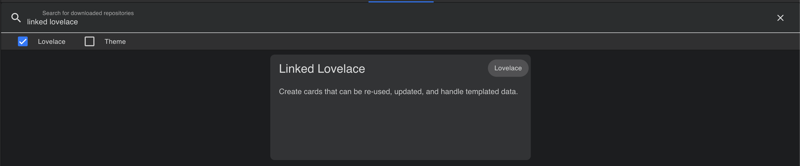
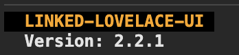
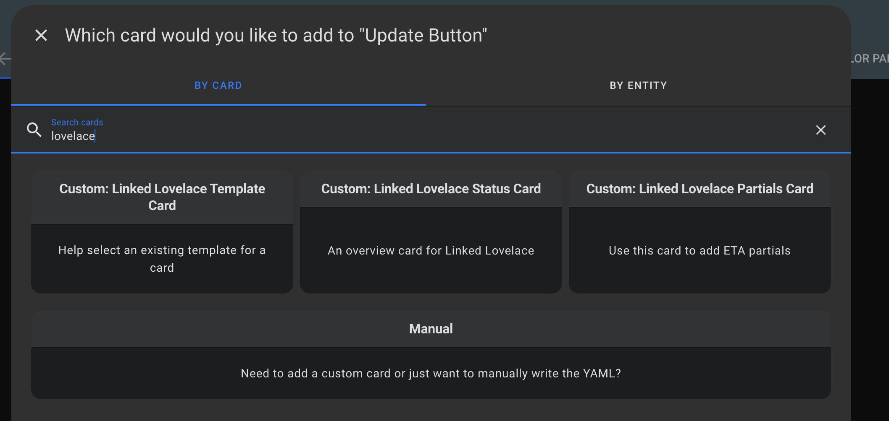

# Getting Started

::: tip Not installed yet? Try it first.
You can play with Linked Lovelace right now — no Home Assistant needed. The
[**Live Demo**](./demo) runs the real template engine in your browser inside a
simulated dashboard.
:::

## Installation

### Prerequisites

- [Home Assistant](https://www.home-assistant.io/)
- [Home Assistant Community Store](https://hacs.xyz/) or knowledge of how to manually install from Github.

::: danger NOTE

`Linked Lovelace` runs commands on behalf of the user's browser to modify dashboard configurations, not on behalf of the Home Assistant system. A user's access may modify the outcome of the program.

__Always back-up your configs if you feel unsure about what you are about to do!__
:::

### Preferred Setup

Find us in the HACS plugin in `frontend` under `Linked Lovelace`

### Manual Setup

If you don't use HACS:

1. Download `linked-lovelace-ui.js` from the [latest GitHub release](https://github.com/daredoes/linked-lovelace-ui/releases/latest).
2. Copy it into your Home Assistant `config/www/` folder.
3. In Home Assistant go to **Settings → Dashboards → ⋮ → Resources → Add Resource** and register `/local/linked-lovelace-ui.js` as a **JavaScript module**.
4. Hard-reload your browser (`Ctrl+Shift+R` / `Cmd+Shift+R`).

::: info Upgrading from v1?
`ll_v1_key` cards still work, but the key scheme and template syntax changed in
v2. See the [migration guide](./advanced-features#migration-from-v1).
:::

## Up and Running

The plugin should inject itself when loading any dashboard in Home Assistant. This can be confirmed in the browser logs, which also include a version number.

Once injected, the custom card type `type: custom:linked-lovelace-status` should be available. 

If it loads successfully, then we are up and running!

## What's Next?

Now that we have Linked Lovelace installed, it's time to learn how to use it!

- **Fastest**: drop the [Starter Dashboard](./starter-dashboard) into your Home Assistant — a working showcase in one click.
- **Hands-on**: learn how to [create your first template](./create-your-first-template).
- **Still deciding?** Experiment safely in the [Live Demo](./demo) first.
