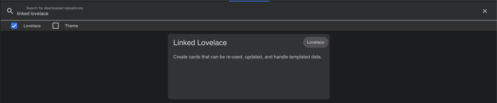
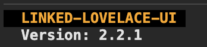
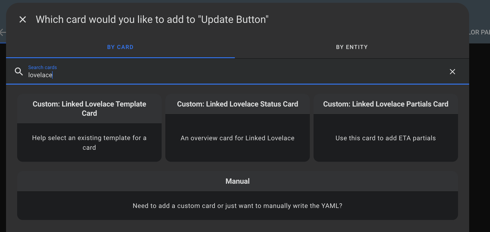

# Getting Started

::: tip Not installed yet? Try it first.
You can play with Linked Lovelace right now without a Home Assistant install. The
[Live Demo](./demo) runs the real template engine in your browser inside a
simulated dashboard.
:::

## How It Works

A template and the cards that use it aren't linked live. A sync copies the template into each of those cards:

1. Add `ll_key` to a card, and that card is now a template.
2. Add `ll_template` with the same value to any other card, and that card is now an instance of the template.
3. Run a sync from the status card. Each instance is overwritten with a rendered copy of its template, saved in your dashboard.

Editing a template changes nothing else until the next sync. The [API Reference](./api-reference#terms) has the rest of the terms.

## Installation

### Prerequisites

- [Home Assistant](https://www.home-assistant.io/)
- [Home Assistant Community Store](https://hacs.xyz/) or knowledge of how to manually install from Github.

::: danger NOTE

`Linked Lovelace` runs commands on behalf of the user's browser to modify dashboard configurations, not on behalf of the Home Assistant system. A user's access may modify the outcome of the program.

__Always back-up your configs if you feel unsure about what you are about to do!__
:::

### Preferred Setup

Find us in the HACS plugin in `frontend` under `Linked Lovelace`

### Manual Setup

If you don't use HACS:

1. Download `linked-lovelace-ui.js` from the [latest GitHub release](https://github.com/daredoes/linked-lovelace-ui/releases/latest).
2. Copy it into your Home Assistant `config/www/` folder.
3. In Home Assistant go to **Settings → Dashboards → ⋮ → Resources → Add Resource** and register `/local/linked-lovelace-ui.js` as a **JavaScript module**.
4. Hard-reload your browser (`Ctrl+Shift+R` / `Cmd+Shift+R`).

::: info Upgrading from v1?
The key scheme and template syntax changed in v2, so v1 cards need migrating. See
the [migration guide](./advanced-features#migration-from-v1).
:::

## Up and Running

The plugin should inject itself when loading any dashboard in Home Assistant. This can be confirmed in the browser logs, which also include a version number.

Once injected, the custom card type `type: custom:linked-lovelace-status` should be available. 

If it loads successfully, then we are up and running!

## Removing Linked Lovelace

Linked Lovelace has no backend, so the only thing it leaves behind is what's in your dashboard configs. Do these in order, since step 2 needs the plugin still installed:

1. On the status card, click **Load Data**, then **Download Backup**.
2. Set `show_key_chips` to `false` on any template that has it, then run a sync. Otherwise those cards stay wrapped in `custom:linked-lovelace-key-chip`, which can't render without the plugin.
3. Delete every remaining card whose type starts with `custom:linked-lovelace`. You can search for them in each dashboard's raw configuration editor.
4. Remove the plugin. In HACS, open Linked Lovelace and remove it, then check that the resource is gone from **Settings → Dashboards → ⋮ → Resources**. If you installed by hand, delete the resource there and delete `linked-lovelace-ui.js` from `config/www/`.
5. Hard-reload your browser (`Ctrl+Shift+R` / `Cmd+Shift+R`).

Cards that were already rendered keep working, they just stop updating since nothing syncs them anymore. Their `ll_template`, `ll_context`, and `ll_keys` keys stay in the config until you delete them. Templates still have raw `<%= %>` text in them, so you probably want to delete those too.

## What's Next?

Now that we have Linked Lovelace installed, it's time to learn how to use it!

- The fastest route is the [Starter Dashboard](./starter-dashboard), which drops a working showcase into your Home Assistant in one click.
- If you'd rather build it yourself, learn how to [create your first template](./create-your-first-template).
- Still deciding? Experiment safely in the [Live Demo](./demo) first.
