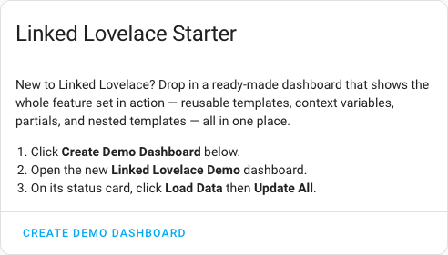
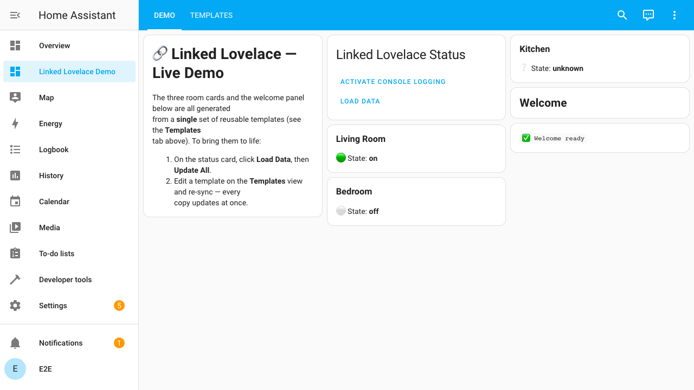

# Starter Dashboard

The fastest way to understand Linked Lovelace is to see it running. The Starter Card builds a complete demo dashboard in your Home Assistant with one click, so you don't have to copy any YAML by hand.

::: tip No Home Assistant handy?
The [Live Demo](./demo) runs this exact showcase in your browser using the real template engine. There is nothing to install.
:::

The demo packs the whole feature set into one dashboard. A single `room` template is rendered three times, each room gets its own `name` and `state` through context variables, a `stateToIcon` partial converts a state into an icon, and a `panel` template nests a `badge` template inside it.

## 1. Add the Starter Card

On any user-created dashboard, add a card with the type `custom:linked-lovelace-starter`. It also shows up in the card picker as **Linked Lovelace Starter Card**.

```yaml
type: custom:linked-lovelace-starter
```



::: tip Optional
You can override where the demo is created:

```yaml
type: custom:linked-lovelace-starter
url_path: my-linked-lovelace-demo   # default: linked-lovelace-demo
title: My LL Demo                   # default: Linked Lovelace Demo
```
:::

## 2. Create the Demo Dashboard

Click **Create Demo Dashboard**. Linked Lovelace creates a new dashboard (`linked-lovelace-demo` by default) and fills it with the showcase config. When it finishes, a link appears on the card. You can open the demo from there or from the sidebar.

::: danger NOTE
Like everything in Linked Lovelace, this runs on behalf of your browser and writes a real storage-mode dashboard to your config. It only creates a new dashboard; it never touches your existing ones.
:::

## 3. Bring It to Life

The demo opens on two views:

- **Demo** holds the cards you'll actually look at: a status card plus the rendered output.
- **Templates** holds the reusable templates and the partial that power them.

On the **Demo** view's status card, click **Load Data**, then **Update All**. The room placeholders become fully rendered cards:



The three room cards (Living Room, Bedroom, Kitchen) all come from the same `room` template, each with its own context. The 🟢 / ⚪ / ❔ icons come from the `stateToIcon` partial, and the Welcome panel is a nested template (`panel` includes `badge`).

## 4. Make a Change and Sync It

Open the **Templates** view and change the `room` template. Adding a line to its `content` works well. Go back to the **Demo** view and click **Update All** again. Every room card updates at once, which is the reason Linked Lovelace exists: you write a card once and sync it wherever it's used.

## Where to Next?

- [Live Demo](./demo) runs the same showcase in your browser, fully editable.
- [Creating Your First Template](./create-your-first-template) walks through building your own.
- [Providing Template Context](./providing-template-context) covers variables in depth.
- [Creating Partials](./creating-partials) shows how to share Eta snippets across templates.
- [Using the Status Card](./using-the-status-card) explains Load Data, dry runs, and Update All.
- [Template Syntax](./template-syntax) is the Eta reference.
