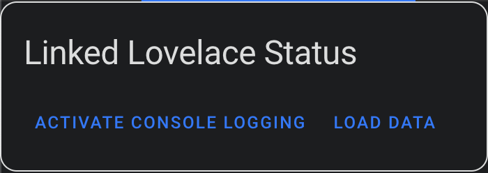
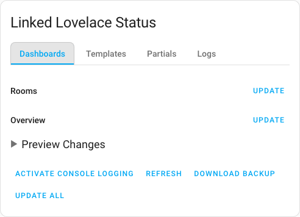
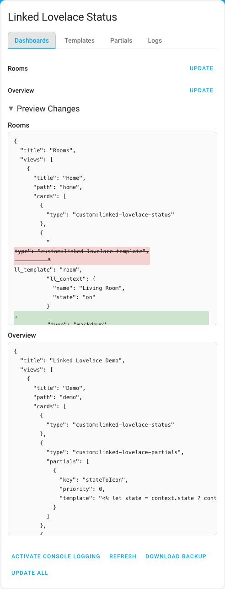
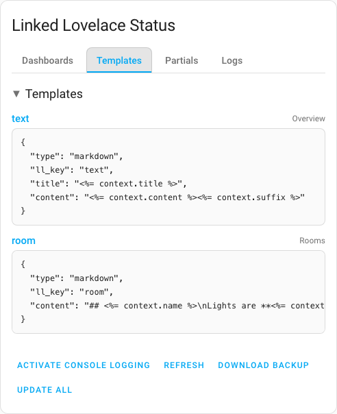

# Using the Status card

It is recommended to use the status card as a singular card in a panel view.

::: danger NOTE

Linked Lovelace runs commands on behalf of the user's browser to modify dashboard configurations, not on behalf of the Home Assistant system. A user's access may modify the outcome of the program.

__Always back-up your configs if you feel unsure about what you are about to do!__
:::

## First Paint

When the card first shows up, it has no information loaded. **_This is intentional._**

In the world of web development, there exists a metric called "Time to First Paint". This represents the amount of time it takes for a user's device to draw something on the screen.

In our case, we want to minimize the time-to-first-paint as the longer this takes, the more resources we are using - A.K.A killing the user's battery.

To this end, the status card performs no actions when being loaded. We wait for user input before collecting information for the card to use.

After first paint, the user should see two buttons - `Activate Console Logging` and `Load Data`.



## Console Logging

`Activate Console Logging` when pressed will cause future actions to output logs to the browser console for local debugging.

- This is disabled by default as it can heavily decrease performance.
- Logs are collected internally still, which can be reviewed once the card has loaded some data.

## Loading Data

`Load Data` when pressed will make a few websocket requests on behalf of the user to determine what dashboards, templates, and partials are available.

- After doing so, it will automatically perform a dry-run with the found changes and store the differences.

## Loaded Tabs

Once data has been loaded, the card will display the following tabs.

### Dashboards



Every dashboard whose rendered output differs from what is currently saved gets a row here, with an **Update** button that writes just that one. If nothing differs, the tab says so and there is nothing to do.

Expand **Preview Changes** to read the diff for each listed dashboard before writing anything. Removed lines are tinted red, added lines green.



**Update All** writes every listed dashboard in one click. Great for experts, but definitely a risky click after making changes!

**Download Backup** saves the configs as they were read, before any write, as a JSON file. Keep it if you want a way back: paste a dashboard's config from that file into the raw configuration editor to restore it.

### Templates

Every template Linked Lovelace found gets a row here: the `ll_key` as a link to the view that defines it, and the dashboard it came from beside it. Click the key to jump straight to the card you would edit.

Expand **Templates** to read each registered body. It is printed the same way as the dashboard diffs above, so a template and a preview look alike.



### Partials

This tab is identical to the templates tab, except that it focuses on all discovered partials. We haven't discussed these yet.

### Logs

This tab contains a scrollable text box featuring logs for each action that has occurred.

If console logging is activated, a more detailed version of each log should be available in the browser logs.

__*This is purely a debugging tool.*__

## Key Chips

The status card itself has no options. Key chips are asked for by the definition card, next to the `ll_key` it already carries:

```yaml
type: markdown
ll_key: room
show_key_chips: true
content: "## <%= context.name %>"
```

The next sync wraps that card in a small container that draws a pill with its `ll_key` in the top right corner. The pill uses your theme's primary color, and you can override it with `--ll-chip-background-color` and `--ll-chip-text-color` (see the [key-chip card reference](./api-reference#custom-linked-lovelace-key-chip)). Handy when you are staring at a dashboard trying to remember which card is the actual template.

Set it to `false` and the next sync removes the wrapper again. Either way nothing happens until you run a sync; the key on its own does not touch your dashboards.

::: info
Because each card asks for its own chip, you can badge the two definitions you keep losing track of and leave the rest alone. It works on cards in a view and on cards inside a section.
:::

## Demonstration

Given all we've discussed, let's put it into action.


## What's Next?

At this point you should be capable of creating a template from a new or existing card, using that template in another dashboard, and synchronizing the changes.

With that, you've accomplished everything featured in `Linked Lovelace 1.0`.

In `Linked Lovelace 2.0` the library [Eta JS](https://eta.js.org/) took over the templating logic. Learn how to use it by [providing Template Context.](./providing-template-context)